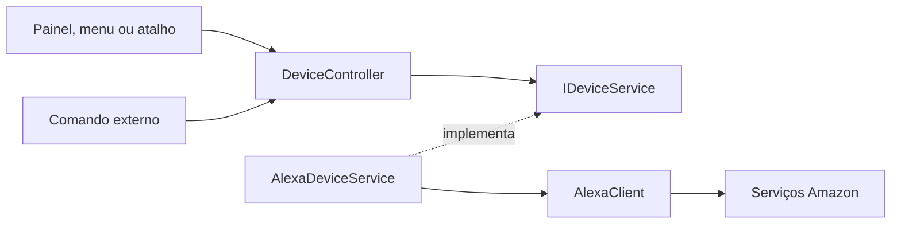

# Arquitetura e organização

O projeto usa uma arquitetura em camadas leve, dentro de um único executável. As responsabilidades ficam separadas em pastas, serviços e componentes pequenos. A interface continua em Windows Forms e o aplicativo continua usando .NET Framework 4.8; não há framework adicional de arquitetura.

## Onde encontrar cada parte

```text
src/
  Domain/                  Modelos, estados e ações de energia
  Application/             Cadastro, validação e controle dos aparelhos
  Infrastructure/
    Alexa/                 Protocolo e autenticação Amazon
    Storage/               Configuração protegida e migração
    Serialization/         Leitura e escrita de JSON
    Windows/               Atalhos globais e inicialização automática
  UI/
    Forms/                 Painel, configurações e login
    Components/            Cartões, linhas editáveis e menu da bandeja
    Theme.cs               Aparência compartilhada
  Localization/            Catálogos incorporados e seleção de idioma
  CLI/                     Comandos externos
  Properties/              Metadados da versão
  Program.cs               Inicialização e composição dos serviços

tests/
  Devices/                 Cadastro, controle e telas dinâmicas
  Alexa/                   Respostas simuladas e segurança do protocolo
  Storage/                 Proteção e importação de dados
```

As pastas representam responsabilidades no mesmo projeto, sem adicionar projetos de biblioteca ou uma estrutura de plugins. Os tipos compartilham o namespace `RoomPilot`; as fronteiras são mantidas pela organização e pelo uso de interfaces.

## Caminho de um comando



`DeviceController` recebe `IDeviceService` pelo construtor. Ele consulta o estado atual, envia um único comando e consulta novamente para confirmar. Ele não conhece HTTP, cookies ou controles visuais. Um serviço falso implementa o mesmo contrato nos testes.

O painel recebe uma fábrica de serviços montada em `Program.cs`; ao salvar configurações, recria seu controlador para usar a sessão atual. As telas de login e configuração usam os componentes de infraestrutura para configurar a conta e salvar os dados.

`AlexaClient` é um único cliente HTTP, dividido em arquivos parciais para facilitar a revisão: transporte, autenticação, descoberta e energia. Eles compartilham a mesma sessão e a mesma política de destinos seguros. Essa separação não cria múltiplas conexões ou modos de autenticação.

## Dispositivos e atalhos

- `DeviceConfig.Key` identifica o controle no aplicativo. É estável e não muda quando o nome é editado.
- `DeviceId` identifica a entidade correspondente na Alexa e permanece protegido no armazenamento.
- `Name` é o nome mostrado ao usuário. Nomes iguais são permitidos; comandos externos por nome exigem uma correspondência única.
- `DeviceCatalog` adiciona e remove controles e preserva os vínculos ao renomear. Remover um controle remove seus atalhos; as alterações do editor são aplicadas ao salvar.
- `ConfigurationRules` rejeita identificadores repetidos, nomes vazios, atalhos inválidos e seleção repetida da mesma entidade Alexa.
- `PowerAction` representa Ligar, Desligar e Alternar no código. Os textos persistidos dos atalhos são convertidos na entrada para manter compatibilidade com configurações antigas.

O painel, o menu e as listas de atalhos são gerados a partir de `AppConfig.Devices`. O painel e o editor têm rolagem. Os três controles iniciais são somente um ponto de partida; não existe validação exigindo três aparelhos.

## Compatibilidade e proteção

O formato atual da configuração é a versão 3. `ConfigStore.Load` converte as versões 1 e 2 em memória, preservando identidades, nomes e atalhos. O arquivo é atualizado quando a pessoa salva. Formatos futuros desconhecidos são rejeitados. Os conectores antigos de canais Tuya não fazem parte do caminho de controle da Alexa.

`DataProtection` concentra o DPAPI. `PrivateStorage` cuida das permissões da pasta e da gravação atômica. Sessão e configuração ficam em `%LOCALAPPDATA%\CasaInteligente`. Veja `SECURITY.md` para os limites da proteção.

## Como expandir

**Mais aparelhos com ligar/desligar:** use o cadastro existente. Não precisa alterar o código nem criar uma classe para cada marca.

**Brilho, cor ou temperatura:** acrescente modelos de capacidades e operações próprias. Primeiro implemente a leitura e a confirmação no conector, depois os controles visuais correspondentes. O contrato atual cobre somente energia; cadastrar um aparelho não habilita automaticamente outras funções.

**Outro fornecedor de conexão:** implemente o contrato de energia e injete o serviço na composição. Se houver múltiplos fornecedores simultâneos, acrescente uma identificação de fornecedor ao modelo e um serviço que encaminhe cada aparelho. Isso ainda não está implementado.

**Grupos e favoritos:** referencie as chaves estáveis dos dispositivos. Remoção e migração devem atualizar essas referências, como já acontece com os atalhos.

## Convenções

- Uma responsabilidade por componente; extraia código repetido quando houver um uso concreto.
- Use nomes descritivos e o sufixo `Async` nas operações assíncronas de controle e serviço.
- Evite juntar várias instruções na mesma linha. A formatação está definida em `.editorconfig`.
- Comente decisões de protocolo, segurança e compatibilidade. O nome do método deve explicar a operação comum.
- Preserve as validações de domínio, a proteção de dados e a confirmação de estado. Não reduza código removendo essas verificações.
- Execute `build.ps1` e `verificar-publicacao.ps1` antes de distribuir. Testes usam dados fictícios e não dependem de uma conta real.

A preferência de idioma e a conversão das versões anteriores estão descritas em `docs/I18N.md`. A marca é room-pilot; a pasta privada e a identidade de instância antigas são mantidas por compatibilidade. A inicialização automática migra a entrada antiga quando aponta para o executável substituído na mesma pasta.
